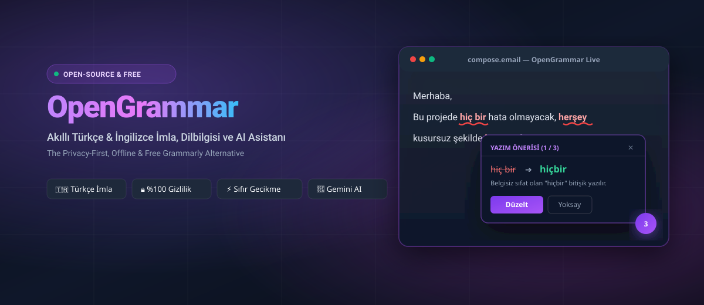

<p align="center">
  
</p>

<p align="center">
  <strong>Gizlilik odaklı, çevrimdışı çalışan, Türkçe & İngilizce akıllı imla, dilbilgisi ve yapay zeka yazım asistanı.</strong><br>
  <em>The Privacy-First, Offline & Open-Source Grammarly Alternative.</em>
</p>

<p align="center">
  <a href="https://opensource.org/licenses/MIT"></a>
  <a href="https://developer.chrome.com/docs/extensions/mv3/intro/"></a>
  <a href="https://github.com/codumtr"></a>
  
</p>

---

## ⚡ Neden Grammarly'den Daha İyi?

Grammarly gibi popüler araçlar kullanıcıların yazdığı her özel e-postayı, şifreyi ve hassas metni kendi bulut sunucularına gönderir; üstelik Türkçe dil desteği neredeyse yoktur ve aylık yüksek abonelik ücretleri ($12 - $30/ay) talep eder.

**OpenGrammar** bu sorunları kökten çözmek için geliştirildi:

| Karşılaştırma | Grammarly | ✍️ **OpenGrammar** |
| :--- | :---: | :---: |
| **Fiyat** | Aylık \$12 - \$30 💸 | **%100 Ücretsiz & Açık Kaynak** 🎁 |
| **Türkçe Dilbilgisi & İmla** | Çok zayıf / Desteklenmiyor ❌ | **Gelişmiş Türkçe Kural & Sözlük Motoru** 🇹🇷 |
| **Gizlilik & Güvenlik** | Her kelime sunucularına kaydedilir ⚠️ | **%100 Yerel (Veriler Cihazınızdan Asla Çıkmaz)** 🔒 |
| **Soru Eki ("mi/mı") Ayrımı** | Yok ❌ | **Akıllı Kök/Ek Ayrımı** (`gelirmisin` ➔ `gelir misin`) ✅ |
| **Bağlaç ve Noktalama Kontrolü** | Kısıtlı ❌ | **Tam Kapsamlı (de/da, virgül boşlukları vb.)** ✅ |
| **Yapay Zeka (AI) Yetenekleri** | Pahalı Premium üyelik gerektirir 💳 | **Kendi Ücretsiz Gemini API Anahtarınızla Sınırsız** 🤖 |

---

## ✨ Öne Çıkan Yetenekler

* **🇹🇷 100+ Yaygın Türkçe Kelime Hatası:**  
  `yalnış` ➔ `yanlış` | `herşey` ➔ `her şey` | `süpriz` ➔ `sürpriz` | `orjinal` ➔ `orijinal` | `yada` ➔ `ya da` | `tabiki` ➔ `tabii ki` ve onlarcası.
* **❓ Soru Eki Ayrımı:**  
  Bitişik yazılan `misin`, `mısın`, `muyuz`, `mü` eklerini otomatik kök analiziyle tespit edip ayırır.
* **🎯 Canlı Sayfa Asistanı (Floating Badge & Card):**  
  Gmail, WhatsApp Web, Twitter/X, LinkedIn, Notion ve web formlarında yazarken sağ altta zarif bir rozet olarak durur. Hata olduğunda anında açılır ve tek tıkla düzeltmenizi sağlar.
* **💼 Yapay Zeka Ton Dönüştürücü (Gemini API Entegrasyonu):**  
  - 👔 **Resmi Yap:** İş ve kurumsal e-postaları için tonu profesyonelleştirir.
  - 😊 **Kibar Yap:** Mesajları daha sıcak ve nezaketli bir dille yeniden kurgular.
  - ✂️ **Özetle:** Uzun paragrafları tek tıkla en yalın haline indirir.
* **📖 Kişisel Sözlük:**  
  Şirket isimleri, sektörel terimler veya özel isimleri ekleyin; asla hata olarak işaretlenmesin.

---

## 📂 Proje Dizin Yapısı

```text
opengrammar/
├── assets/
│   └── banner.svg             # README vitrin görseli ve vektör banner
├── manifest.json              # Chrome Manifest V3 yapılandırması
├── engine/
│   └── engine.js              # %100 yerel çalışan Türkçe & İngilizce imla motoru
├── content/
│   ├── content.js             # Sayfa içi metin kutularına bağlanan canlı asistan
│   └── content.css            # Modern mor/fuşya açılır kart ve rozet stilleri
├── background/
│   └── service-worker.js      # Yapay zeka dönüşümleri ve arka plan servisi
├── popup/
│   ├── popup.html             # Hızlı metin denetleme penceresi
│   ├── popup.css              # Koyu/neon arayüz stilleri
│   └── popup.js               # Canlı denetleme ve düzeltme denetleyicisi
├── options/
│   ├── options.html           # Gemini API anahtarı ve özel sözlük yönetim paneli
│   ├── options.css            # Gelişmiş ayarlar stilleri
│   └── options.js             # Ayarlar yöneticisi
├── icons/                     # 16, 32, 48, 128 px ikonlar
├── LICENSE                    # MIT Lisansı
└── README.md                  # Dokümantasyon
```

---

## 🛠️ Kurulum (Tarayıcınıza Yükleyin)

1. Depoyu klonlayın veya zip olarak indirin:
   ```bash
   git clone https://github.com/codumtr/opengrammar.git
   ```
2. Google Chrome'u açıp adres çubuğuna şunu yazın:  
   `chrome://extensions/`
3. Sağ üstteki **"Geliştirici modu" (Developer mode)** anahtarını açın.
4. Sol üstte çıkan **"Paketlenmemiş öge yükle" (Load unpacked)** butonuna tıklayın.
5. İndirdiğiniz `opengrammar` klasörünü seçin.
6. 🎉 **OpenGrammar hazır!** İstediğiniz sitede yazı yazmaya başlayabilirsiniz.

---

## 🤝 Katkıda Bulunma (Contributing)

Topluluk katkılarına tamamen açığız!
1. Depoyu forklayın (`Fork`).
2. Yeni kural/kelime için dal açın (`git checkout -b feature/yeni-kurallar`).
3. Değişikliklerinizi commit edin (`git commit -m 'feat: yeni Türkçe sözlük kuralları eklendi'`).
4. Dalınıza gönderin (`git push origin feature/yeni-kurallar`).
5. Bir **Pull Request (PR)** oluşturun!

---

## 📄 Lisans

Bu proje **MIT Lisansı** ile korunmaktadır.  
Geliştirici: **[CODUM.TR](https://github.com/codumtr)**
